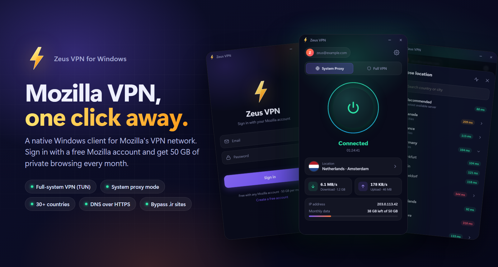
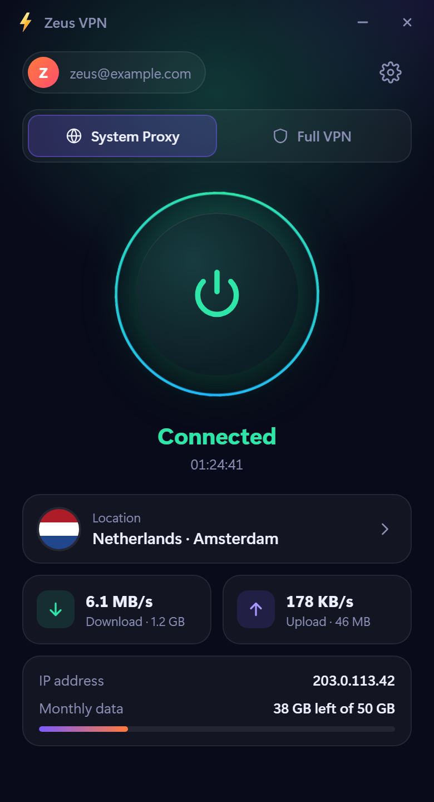
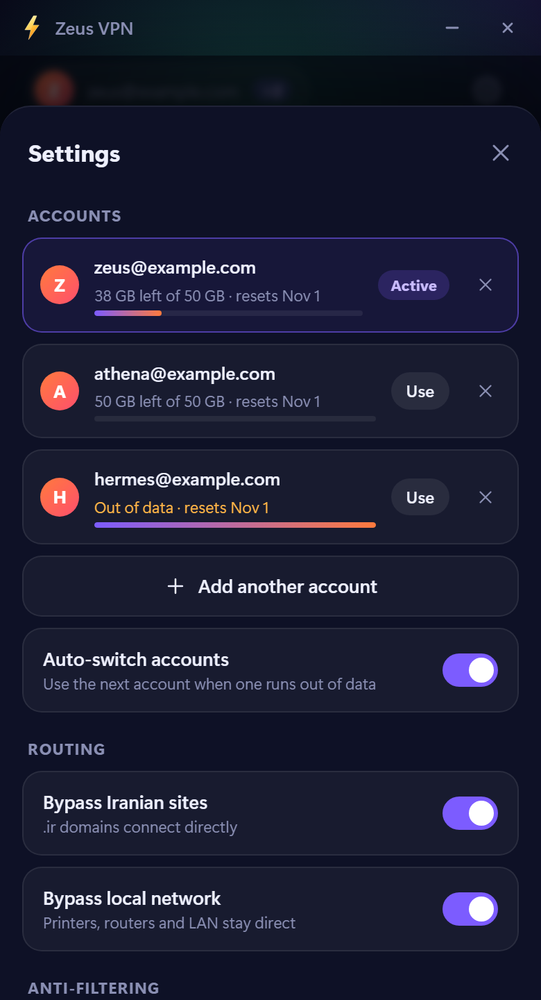
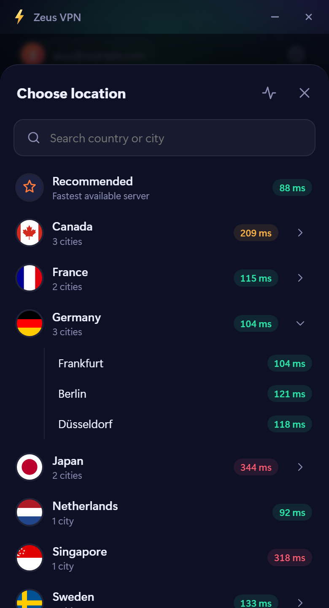
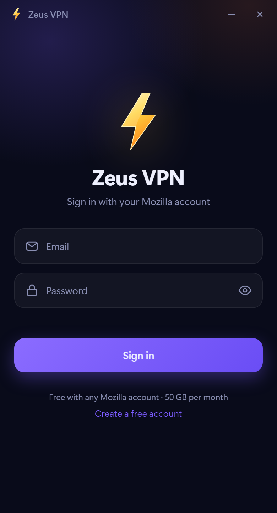

<p align="center">
  
</p>

<h1 align="center">⚡ Zeus VPN</h1>

<p align="center">
  A client for Mozilla's VPN network for Windows, macOS, Linux, Android and iOS.<br>
  Sign in with a free Mozilla account, pick a country, press one button.
</p>

<p align="center">
  
  
  
</p>

---

## Features

- **Every platform**: Windows, macOS, Linux, Android and iOS, with the same app and settings everywhere.
- **Two connection modes** on the desktop
  - **System Proxy**: routes browsers and most apps; no administrator rights needed.
  - **Full VPN (TUN)**: a virtual network adapter that tunnels *every* app on the system, like WireGuard or v2rayN's TUN mode. The phone apps always work this way.
- **Mozilla account sign-in** with email verification codes, confirmation links and unblock codes all handled in the app.
- **Multiple accounts with auto-switch**: add as many Mozilla accounts as you like. When one runs out of its monthly data, Zeus VPN moves to the account with the most data left, without dropping the connection.
- **30+ countries and cities**, with live latency tests, search and an automatic *Recommended* option.
- **Anti-filtering**: TLS ClientHello fragmentation hides server names from SNI filters (automatic when a handshake is blocked), and VPN server addresses are resolved over DNS-over-HTTPS.
- **DNS over HTTPS** through the tunnel in Full VPN mode, so DNS lookups are not visible to or poisoned by the local network.
- **Smart routing**: optionally keep `.ir` sites and your local network (printers, router) off the VPN.
- **Per-app tunnelling** (Android): tunnel only the apps you choose, or everything except a few — picked from a searchable list in Settings.
- **Live stats**: download/upload speed, exit IP and your remaining monthly data (50 GB free per month).
- **Local HTTP + SOCKS5 proxy** on `127.0.0.1:10820` for apps that need manual proxy settings (Telegram, browsers, git, ...).
- **Safe by design**: your previous proxy settings (for example v2rayN's) are restored on disconnect, even after a crash; sign-in tokens are encrypted (with Windows DPAPI, a key in the macOS Keychain, or a private key file on Linux and mobile).
- **Kill switch** (Windows): if the VPN drops, the Windows firewall blocks all other traffic until Zeus VPN reconnects or you disconnect, so nothing leaks outside the tunnel (optional, needs administrator).
- **Self-healing connection**: dropped connections are detected and restored automatically (moving to another server if needed), the short-lived proxy pass is renewed in the background, and a rejected pass is replaced on the spot.
- Start at login (desktop), connect on launch, and a log for troubleshooting (on Windows in `%APPDATA%\ZeusVPN\zeusvpn.log`).

<p align="center">
  
  &nbsp;
  
  &nbsp;
  
  &nbsp;
  
</p>

## Install

Download the file for your system, open **Zeus VPN**, sign in with your [Mozilla account](https://accounts.firefox.com/signup) and press the power button.

| Platform | Download | Notes |
|---|---|---|
| **Windows** 10/11 | [`ZeusVPN-amd64-installer.exe`](https://github.com/Khode-ZeUS/Zeus-VPN/releases/latest) | Installs shortcuts, and Microsoft Edge WebView2 if missing. A portable `ZeusVPN.exe` is on the same page. |
| **Android** 7+ | [`ZeusVPN-android-arm64-v8a.apk`](https://github.com/Khode-ZeUS/Zeus-VPN/releases/latest) (most phones), `-armeabi-v7a` (older phones) or `-universal` | Allow installing apps from your browser or file manager. |
| **Linux** x86-64 | [`zeusvpn_<version>_amd64.deb`](https://github.com/Khode-ZeUS/Zeus-VPN/releases/latest) (Ubuntu, Debian, Mint) or `ZeusVPN-linux-amd64.tar.gz` | Install with `sudo apt install ./zeusvpn_<version>_amd64.deb`. Needs WebKitGTK 4.1 (Ubuntu 22.04+, Debian 12+, Fedora 36+). |
| **macOS** 10.15+ (Apple silicon and Intel) · *beta* | [`ZeusVPN-macos-universal-beta.dmg`](https://github.com/Khode-ZeUS/Zeus-VPN/releases/latest) | Drag to Applications. The app is not notarized: the first time, right-click it and choose **Open** (or run `xattr -cr "/Applications/Zeus VPN.app"`). |
| **iOS / iPadOS** 15+ · *beta* | [`ZeusVPN-ios-unsigned-beta.ipa`](https://github.com/Khode-ZeUS/Zeus-VPN/releases/latest) | Must be signed with your own Apple Developer account, see [iOS](#ios). |

The macOS and iOS versions are in beta: they are built from the same code but have not been fully tested yet. If something doesn't work, please [open an issue](https://github.com/Khode-ZeUS/Zeus-VPN/issues) with the log (Settings → View logs).

**Full VPN mode** routes every app through the VPN:

- **Windows**: needs administrator rights to create the network adapter; Zeus VPN asks to restart itself as administrator.
- **macOS and Linux**: the app stays a normal app. When you connect in Full VPN mode it asks for your administrator password and starts a small helper that runs the adapter (on Linux through polkit/`pkexec`).
- **Android and iOS**: always Full VPN, through the system VPN permission (asked once). The local proxy `127.0.0.1:10820` also works for other apps.

The VPN server's own addresses are excluded from the adapter's routes on every platform, so the engine's tunnel connection always goes out through the physical network and cannot loop back into the tunnel it is carrying.

**Per-app tunnelling** (Android): in Settings → *Full VPN apps*, choose *Selected only* to tunnel just the apps you pick, or *Except selected* to tunnel everything but a few (banking apps, local services, …). Other platforms route all apps: iOS per-app VPN needs MDM profiles, and the desktop TUN stack has no per-app filter.

The kill switch is Windows-only. On the other systems Full VPN mode keeps the adapter up while it reconnects, so traffic does not leave outside the tunnel; on Android you can also turn on *Always-on VPN* and *Block connections without VPN* in the system settings.

## How it works

```
 apps ──► System proxy (HTTP/SOCKS5 on 127.0.0.1:10820) ─┐
                                                        ├─► HTTP/2 CONNECT tunnel ─► Mozilla VPN server ─► internet
 apps ──► Zeus VPN TUN adapter ─► userspace TCP/IP stack ─┘     (TLS, bearer proxy-pass)
```

All platforms share the Go engine and the same web UI (`frontend/dist`). The desktop apps use [Wails](https://wails.io/); the Android and iOS apps load the UI in a WebView and reach the engine through [gomobile](https://pkg.go.dev/golang.org/x/mobile/cmd/gomobile) bindings (`mobile/`) and a small JavaScript bridge (`frontend/dist/bridge.js`).

1. Zeus VPN signs in to **Firefox Accounts** (the same onepw protocol Firefox uses) and obtains an OAuth token for the VPN scope.
2. It asks Mozilla's **Guardian** service for a short-lived *proxy pass* and renews it automatically before it expires.
3. Every TCP connection is carried as an **HTTP/2 CONNECT** stream to the selected Mozilla server; plain HTTP is forwarded as proxy requests.
4. In Full VPN mode a virtual adapter captures all traffic: [WinTun](https://www.wintun.net/) on Windows, utun on macOS and iOS, `/dev/net/tun` on Linux, and the `VpnService` interface on Android. Destinations are recovered from the TLS SNI / HTTP Host, so sites are resolved on the VPN side, and DNS is answered with DNS over HTTPS through the tunnel.

## Build from source

[`.github/workflows/build.yml`](.github/workflows/build.yml) builds every platform on each push; pushing a tag such as `v1.1.0.1` also publishes a GitHub Release with all the files and the notes from `RELEASE_NOTES.md`. To build by hand you need Go 1.26+ and, for the desktop apps, the [Wails v2 CLI](https://wails.io/docs/gettingstarted/installation):

```bash
go install github.com/wailsapp/wails/v2/cmd/wails@v2.16.0
```

### Windows

Needs [NSIS](https://nsis.sourceforge.io/) for the installer.

```bash
wails build -tags with_gvisor -trimpath -ldflags "-s -w" -nsis
```

The app is written to `build/bin/ZeusVPN.exe` and the installer to `build/bin/ZeusVPN-amd64-installer.exe`.

### macOS

Needs the Xcode command line tools. Builds `build/bin/ZeusVPN.app` for Apple silicon and Intel:

```bash
wails build -platform darwin/universal -tags with_gvisor -trimpath -ldflags "-s -w"
```

### Linux

Needs GTK 3 and WebKitGTK 4.1 development files (`sudo apt install build-essential pkg-config libgtk-3-dev libwebkit2gtk-4.1-dev`):

```bash
wails build -platform linux/amd64 -tags "with_gvisor webkit2_41" -trimpath -ldflags "-s -w"
build/linux/package.sh 1.1.0.0 amd64
```

The `.deb` and `.tar.gz` are written to `build/bin`.

### Android

Needs the Android SDK and NDK, JDK 17 and Gradle 8.11. Build the Go library first, then the app:

```bash
go install golang.org/x/mobile/cmd/gomobile@latest golang.org/x/mobile/cmd/gobind@latest
gomobile init
gomobile bind -target=android -androidapi 24 -tags with_gvisor -trimpath -ldflags="-s -w" -o android/app/libs/zeuscore.aar ./mobile
gradle -p android assembleRelease
```

The APKs are in `android/app/build/outputs/apk/release/`. Release builds are signed with the keystore named by the `ZEUS_KEYSTORE`, `ZEUS_KEYSTORE_PASSWORD`, `ZEUS_KEY_ALIAS` and `ZEUS_KEY_PASSWORD` environment variables (in CI: the `ANDROID_KEYSTORE_BASE64`, `ANDROID_KEYSTORE_PASSWORD`, `ANDROID_KEY_ALIAS` and `ANDROID_KEY_PASSWORD` secrets), or with the debug key if none is set. Use the same keystore for every release so that updates install over the previous version. After building the `.aar` you can also open `android/` in Android Studio.

### iOS

iOS only runs VPN apps signed with a paid [Apple Developer](https://developer.apple.com/programs/) account (the Network Extension entitlement); free accounts and the unsigned `.ipa` from the releases cannot run the VPN as they are. On a Mac with Xcode and [XcodeGen](https://github.com/yonaskolb/XcodeGen):

```bash
gomobile bind -target=ios,iossimulator -iosversion 15.0 -tags with_gvisor -trimpath -ldflags="-s -w" -o ios/Frameworks/Zeuscore.xcframework ./mobile
cd ios && xcodegen generate && open ZeusVPN.xcodeproj
```

In Xcode, select your team for both targets (`ZeusVPN` and `PacketTunnel`). If you change the bundle identifiers (`com.zeusvpn.app`, `com.zeusvpn.app.tunnel`), also change the app group `group.com.zeusvpn.app` in both `.entitlements` files and in `ios/Shared/Shared.swift`. Then run on a device, or archive for TestFlight or ad-hoc distribution.

| Path | What it does |
|---|---|
| `internal/mozilla` | Firefox Accounts login, Fastly challenge solver, Guardian proxy pass, server list |
| `internal/tunnel` | HTTP/2 CONNECT session pool, local HTTP/SOCKS proxy |
| `internal/vpn` | TUN mode: adapter, routing, traffic sniffing, DNS over HTTPS |
| `internal/tunhelper` | macOS and Linux: the privileged helper that runs the adapter in Full VPN mode |
| `internal/sysproxy` | System proxy (Windows, macOS, GNOME and KDE) with backup and restore |
| `internal/core` | Connection lifecycle |
| `internal/appapi` | The API the UI calls, shared by all platforms |
| `mobile` | gomobile library for Android and iOS |
| `android`, `ios` | The mobile apps (Kotlin `VpnService`, Swift `NEPacketTunnelProvider`) |
| `frontend/dist` | The UI (plain HTML, CSS and JavaScript) |

## راهنمای فارسی

**Zeus VPN** برنامه‌ای برای وصل شدن به سرورهای VPN موزیلا است و برای ویندوز، مک، لینوکس، اندروید و iOS نسخه دارد. فقط با یک اکانت رایگان موزیلا وارد می‌شوید و ماهانه ۵۰ گیگابایت ترافیک رایگان دارید. دیگر نیازی به پیدا کردن کانفیگ v2ray نیست.

- **System Proxy**: مرورگرها و بیشتر برنامه‌ها از VPN رد می‌شوند و دسترسی ادمین لازم ندارد.
- **Full VPN**: همه‌ی برنامه‌های سیستم (حتی بازی‌ها و برنامه‌هایی که پروکسی را پشتیبانی نمی‌کنند) از VPN رد می‌شوند. اولین بار برنامه برای دسترسی ادمین سؤال می‌کند.
- **چند اکانت**: می‌توانید چند اکانت موزیلا اضافه کنید (تنظیمات ← Add another account). وقتی حجم یکی تمام شود، برنامه خودش بدون قطع شدن اتصال به اکانت بعدی سوییچ می‌کند.
- **کیل سوییچ (Kill switch)**: اگر VPN قطع شود، اینترنت کل سیستم قطع می‌شود تا وقتی که VPN دوباره وصل شود یا خودتان آن را خاموش کنید؛ پس هیچ ترافیکی بیرون از VPN رد نمی‌شود. از تنظیمات فعال می‌شود و دسترسی ادمین لازم دارد.
- **ضد فیلترینگ**: اگر فیلترینگ اتصال به سرورها را ببندد، برنامه خودش TLS را تکه‌تکه (fragment) می‌فرستد تا اسم سرور (SNI) دیده نشود.
- **تونل انتخابی اپ‌ها (اندروید)**: از تنظیمات ← Full VPN apps می‌توانید فقط اپ‌های انتخابی از VPN رد شوند (یا همه به‌جز چند اپ خاص، مثلاً برنامه‌ی بانکی).
- سایت‌های `.ir` به‌صورت پیش‌فرض مستقیم باز می‌شوند (قابل تغییر در تنظیمات).
- DNS در حالت Full VPN از داخل تونل و به‌صورت رمزنگاری‌شده (DoH) انجام می‌شود، پس آلودگی DNS مشکلی ایجاد نمی‌کند.
- برای برنامه‌هایی مثل تلگرام می‌توانید پروکسی `127.0.0.1:10820` (HTTP یا SOCKS5) را دستی تنظیم کنید.

**نصب:** فایل مناسب سیستم خود را دانلود کنید، وارد اکانت موزیلا شوید و دکمه‌ی اتصال را بزنید:

- **ویندوز:** فایل `ZeusVPN-amd64-installer.exe` از [آخرین نسخه](https://github.com/Khode-ZeUS/Zeus-VPN/releases/latest).
- **اندروید:** فایل `ZeusVPN-android-arm64-v8a.apk` از [آخرین نسخه](https://github.com/Khode-ZeUS/Zeus-VPN/releases/latest) برای بیشتر گوشی‌ها (اگر مطمئن نیستید، نسخه‌ی `universal`). در اندروید همیشه حالت Full VPN فعال است و بار اول اجازه‌ی VPN پرسیده می‌شود.
- **لینوکس:** فایل `.deb` از [آخرین نسخه](https://github.com/Khode-ZeUS/Zeus-VPN/releases/latest) برای اوبونتو، دبیان و مینت (نصب با `sudo apt install ./zeusvpn_<version>_amd64.deb`)، یا فایل `.tar.gz` برای توزیع‌های دیگر. در حالت Full VPN رمز ادمین از طریق polkit پرسیده می‌شود.
- **مک و iOS (بتا):** این نسخه‌ها هنوز کامل تست نشده‌اند؛ فایل‌هایشان در [آخرین نسخه](https://github.com/Khode-ZeUS/Zeus-VPN/releases/latest) کنار بقیه‌ی پلتفرم‌ها است. اگر مشکلی دیدید، لاگ برنامه را (Settings ← View logs) در بخش [Issues](https://github.com/Khode-ZeUS/Zeus-VPN/issues) بفرستید.
  - **مک:** فایل `ZeusVPN-macos-universal-beta.dmg`. برنامه را به Applications بکشید. بار اول روی برنامه راست‌کلیک کنید و **Open** را بزنید (برنامه notarize نشده است). در حالت Full VPN، مک رمز ادمین را می‌پرسد.
  - **iOS و آیپد:** اپل فقط برنامه‌های VPN امضاشده با اکانت پولی Apple Developer را اجرا می‌کند. برای همین فایل `ipa` بدون امضا است و باید با اکانت خودتان امضا و نصب شود (توضیحات در بخش iOS بالا).

کیل سوییچ فقط در ویندوز است. در سیستم‌های دیگر، حالت Full VPN هنگام قطعی کارت شبکه‌ی مجازی را نگه می‌دارد تا ترافیکی بیرون از VPN نرود. در اندروید می‌توانید از تنظیمات گوشی گزینه‌های *Always-on VPN* و *Block connections without VPN* را هم روشن کنید.

## Credits

- [Vauth/FoxyVPN](https://github.com/Vauth/FoxyVPN): the original FoxyVPN client whose protocol work this project is based on.
- [WireGuard for Windows](https://git.zx2c4.com/wireguard-windows/): the Windows Filtering Platform code behind the kill switch (MIT).
- [Mozilla VPN](https://www.mozilla.org/products/vpn/): the VPN network and account system.
- [Wails](https://wails.io/), [sing-tun](https://github.com/SagerNet/sing-tun), [WinTun](https://www.wintun.net/) and [flag-icons](https://github.com/lipis/flag-icons).

## Disclaimer

Zeus VPN is an independent open-source project and is not affiliated with or endorsed by Mozilla. "Mozilla" and "Firefox" are trademarks of the Mozilla Foundation. Use of Mozilla's service is subject to Mozilla's terms.

## License

[MIT](LICENSE)
